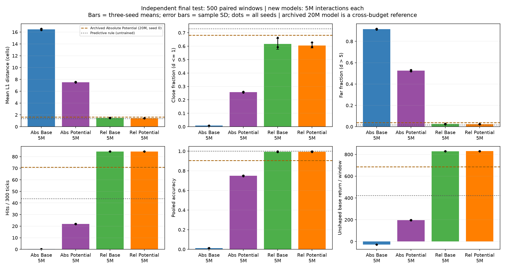
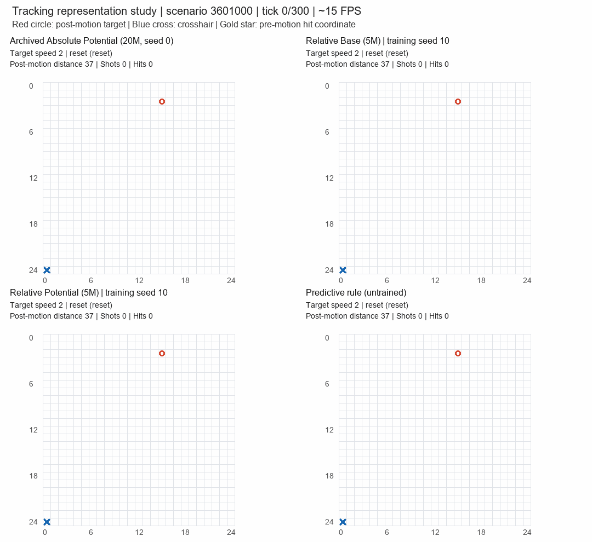
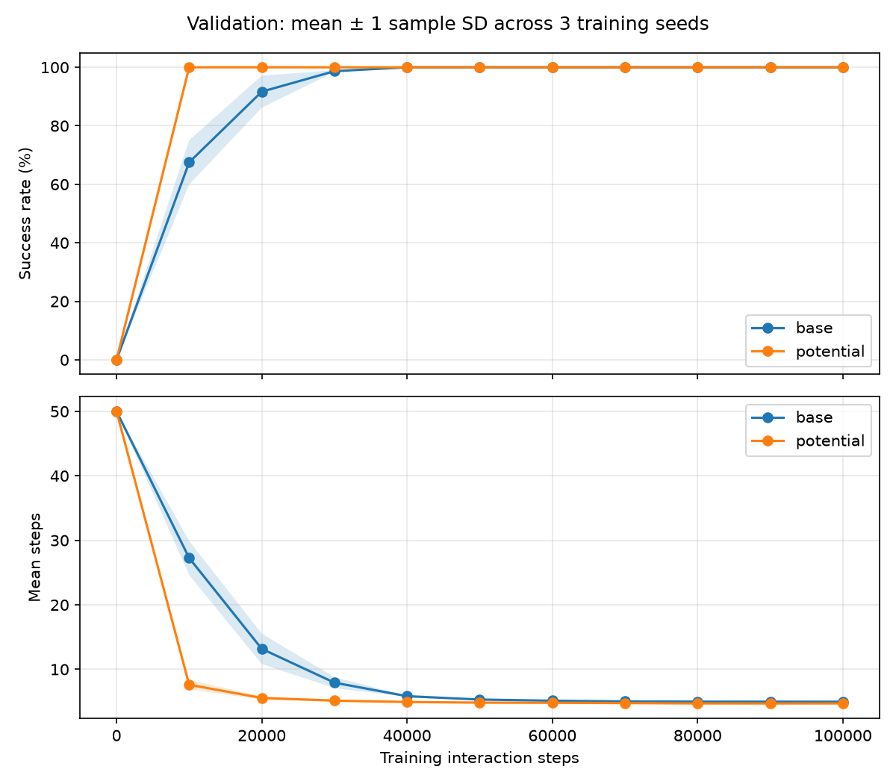
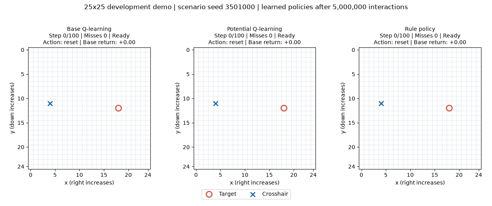
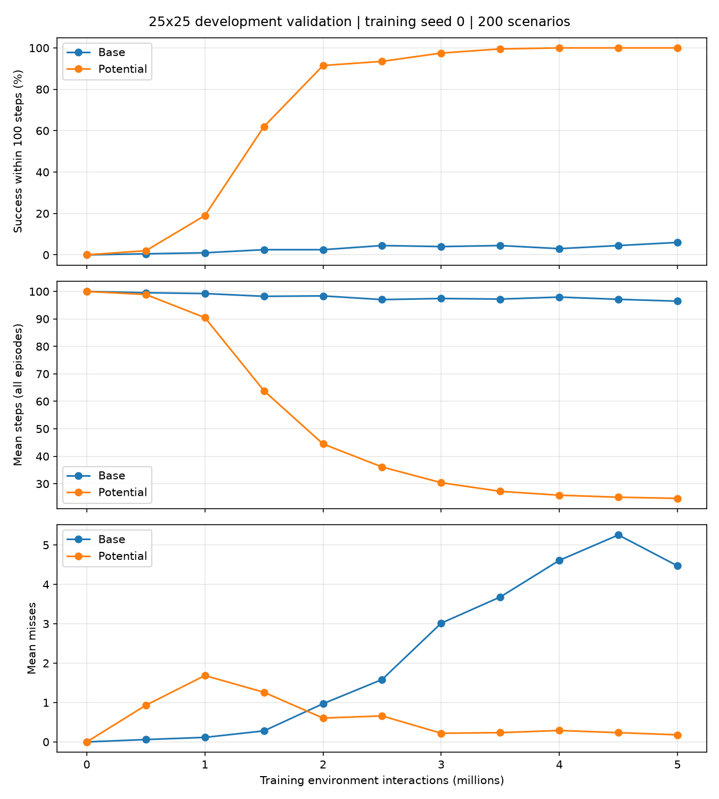
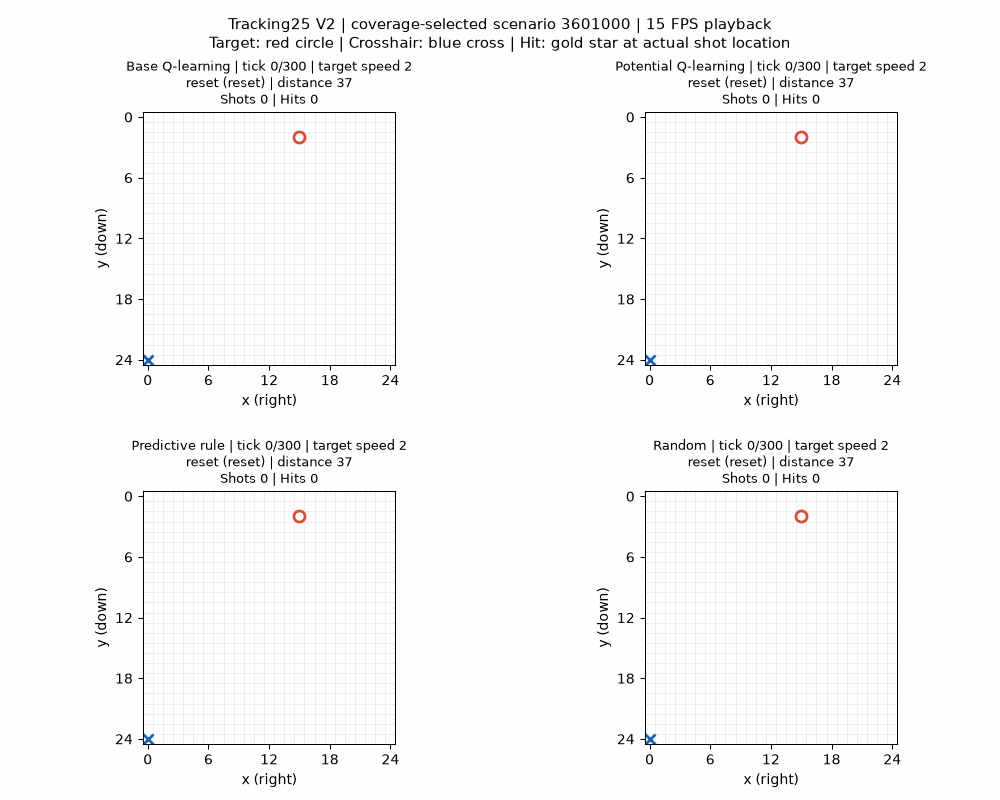
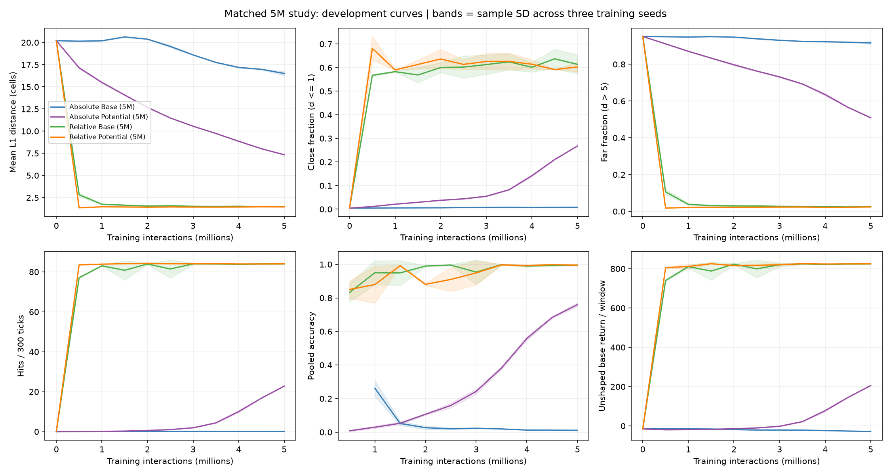

# AimRL: Grid Aiming and Continuous Tracking

A CPU-based reinforcement-learning research project for ELEN E6885. The project studies how reward shaping and state representation affect learning to aim at and continuously follow a moving target. The simulator supplies coordinates directly; the learned controller selects its actions without a rule-policy override.

**Current status:** the small-grid benchmark, larger-grid trial, continuous-tracking development, and three-seed representation study are complete and published. The latest study contains **12 fresh runs, 60,000,000 formal interactions, and 400,000 separate disposable pilot interactions**. A course-format final paper remains to be completed.

[Latest results](#latest-results) · [Progress, step by step](#progress-step-by-step) · [Demonstrations](#demonstrations) · [Artifact locations and path changes](#artifact-locations-and-path-changes) · [Installation and verification](#installation-and-verification) · [Limitations and next work](#limitations-and-next-work)

The [detailed research history](docs/project_history.md) records the reasoning behind each change. The [artifact guide](docs/artifact_paths.md) explains exact file locations, historical-to-current path mappings, and how to open the demonstrations.

## Latest results

### Matched representation study

All four methods use the same 25 by 25 continuous-tracking environment, 300-tick windows, ten actions, five-million-interaction budget, and exploration schedule. Training seeds are 10, 11, and 12. Each final model is evaluated on the same 500 independent final-test scenarios. Values below are **mean ± sample standard deviation across three training seeds**, not confidence intervals.

Distance is Manhattan distance, `|xc-xt| + |yc-yt|`, measured after target motion. Close means distance <=1; far means distance >5. The initial animation frame is excluded from tick-weighted metrics. Hits are counted per 300-tick window; shot accuracy is pooled as total hits / total shots within each training seed before averaging across seeds.

| Method | Mean L1 distance (cells) | Close fraction (%) | Far fraction (%) | Hits / 300 ticks | Shot accuracy (%) |
| --- | --- | --- | --- | --- | --- |
| Absolute Base | 16.469 ± 0.105 | 0.848 ± 0.037 | 91.502 ± 0.384 | 0.177 ± 0.012 | 1.200 ± 0.132 |
| Absolute Potential | 7.531 ± 0.064 | 25.808 ± 0.351 | 52.509 ± 0.618 | 21.873 ± 0.235 | 74.913 ± 0.447 |
| Relative Base | 1.502 ± 0.034 | 61.655 ± 4.022 | 2.521 ± 0.269 | 84.442 ± 0.130 | 99.396 ± 0.431 |
| Relative Potential | 1.440 ± 0.022 | 60.540 ± 1.951 | 2.338 ± 0.147 | 84.489 ± 0.116 | 99.493 ± 0.304 |

**Interpretation.** Relative position sharing improved both reward modes compared with their matched absolute-state controls. Relative Potential has lower mean distance and far fraction than Relative Base, but a lower close fraction; their hit counts are similar. This is evidence for a useful state-representation choice in this experiment, not a claim that shaping wins on every metric.

The relative table contains 192,080 Q entries and 768,320 float32 element bytes, compared with 31,250,000 entries and 125,000,000 bytes for the absolute table. The approximately 163-fold reduction describes table storage only. Relative offsets omit absolute wall information, so this controller uses an approximate observation aggregation rather than an exact Markov state.

**Data:** [cross-seed statistics and target checks](results/tracking_improvement/evaluation/cross_seed_summary.json), [all final-test records](results/tracking_improvement/evaluation/final/), and [all per-seed results and interpretation](results/tracking_improvement/results_summary.md).



### See the current behavior



This actual rollout contains the initial frame and all 300 ticks: **301 frames, 20.07 seconds**. Red circles are targets and blue crosses are crosshairs. All panels see the same target trajectory; hits do not stop the animation. The new learned panels use the predeclared training seed 10. The archived Potential panel uses seed 0 and 20 million training interactions, while the new models use five million; this mixed-budget display illustrates behavior. The table above is the equal-budget comparison.

[Scenario 3601000](results/tracking_improvement/render/seed3601000_main_comparison.gif) · [Scenario 3601001](results/tracking_improvement/render/seed3601001_main_comparison.gif) · [Scenario 3601002](results/tracking_improvement/render/seed3601002_main_comparison.gif) · [Six-policy comparison](results/tracking_improvement/render/seed3601000_six_policy_comparison.gif)

### References on the same final-test scenarios

These references were evaluated once each and have no training-seed standard deviation. The archived model has a different training budget and schedule.

| Reference | Mean distance | Close (%) | Far (%) | Hits/window | Accuracy (%) |
| --- | --- | --- | --- | --- | --- |
| Archived Absolute Base: 20M, seed 0 | 16.277 | 2.707 | 89.373 | 2.722 | 7.334 |
| Archived Absolute Potential: 20M, seed 0 | 1.651 | 68.169 | 3.847 | 70.770 | 90.575 |
| Predictive rule: untrained | 1.371 | 73.041 | 1.649 | 43.730 | 100.000 |
| Random: untrained negative control | 16.977 | 0.648 | 92.327 | 0.042 | 0.140 |

The predictive rule stays closer to the target, while the relative learned policies obtain more hits. Firing uses an action tick and is checked before target motion; the target then moves while the crosshair stays in place. Accurate shooting and post-motion proximity therefore measure different aspects of control.

### Stress results and practical targets

The independent stress split doubles target turn and speed-toggle probabilities from 0.05 to 0.10, keeping the other mechanics unchanged. Each final model is evaluated on 200 shared scenarios. Values are again mean ± sample SD across three training seeds.

| Method | Mean L1 distance (cells) | Close fraction (%) | Far fraction (%) | Hits / 300 ticks | Shot accuracy (%) |
| --- | --- | --- | --- | --- | --- |
| Absolute Base | 16.494 ± 0.058 | 0.722 ± 0.033 | 92.048 ± 0.071 | 0.118 ± 0.039 | 0.772 ± 0.253 |
| Absolute Potential | 8.401 ± 0.039 | 18.448 ± 0.144 | 59.113 ± 0.090 | 15.003 ± 0.340 | 66.249 ± 0.747 |
| Relative Base | 1.673 ± 0.028 | 55.963 ± 3.481 | 2.901 ± 0.370 | 73.648 ± 0.331 | 99.067 ± 0.702 |
| Relative Potential | 1.622 ± 0.019 | 54.999 ± 1.571 | 2.746 ± 0.158 | 73.710 ± 0.111 | 99.100 ± 0.638 |

Relative Potential passed the predeclared practical comparison against matched Absolute Potential: at least 10% lower mean distance, at least five percentage points more close tracking, no higher far fraction, at least 90% of control hits, and at least 85% accuracy. The separately assessed absolute targets are:

| Predeclared absolute target | Measured mean | Status |
| --- | --- | --- |
| Mean distance <=1.5 cells | 1.440 | Achieved |
| Close fraction >=75% | 60.540 | **Not achieved** |
| Far fraction <=5% | 2.338 | Achieved |
| Mean capped acquisition <=15 ticks | 8.287 | Achieved |

The first-acquisition metric uses the first post-motion distance <=1; failures are capped at 300 with a separate acquired flag. The missed close-tracking target remains visible rather than being replaced after evaluation. Stress records are in [evaluation/stress](results/tracking_improvement/evaluation/stress/).

## Progress, step by step

Each item states the motivation, implementation, observed result, and resulting research decision. These are completed research milestones, not claims that each experiment measured the same task.

| Milestone | Main question | Completed output | Result and next decision |
|---|---|---|---|
| 1. Feasibility and specification | Can a small aiming study run reproducibly on a local CPU? | Configuration, package structure, setup checks, and explicit environment/learning rules | A 30,000-byte small-grid Q table made a bounded first experiment practical |
| 2. Environment and baselines | Do movement, firing, termination, and random seeds work correctly? | Grid environment, rule/random policies, automated rendering, and environment tests | Rule success 100%; random success 25% in the initial diagnostic |
| 3. Basic Q-learning | Can an agent learn aiming through interaction? | Training, isolated validation, saved models, and reload checks | Moving-target validation reached 100%; the limited static diagnostic remained weak |
| 4. Reward shaping | Can distance information accelerate learning? | Potential-based reward transformation and a matched development comparison | Shaping reached the success threshold earlier in the single-seed comparison |
| 5. Small-grid benchmark | Does the observation persist across training seeds? | Six formal runs and independent tests at three movement probabilities | Both methods reached 100% final success; shaping usually used fewer steps |
| 6. Larger-grid development | Does learning remain effective when the table grows? | Two 25 by 25 trials and a real rollout GIF | Base success 6%; Potential 100%; one-hit success did not measure sustained tracking |
| 7. Continuous tracking | Can the agent follow wider motion, turning, and speed changes? | Continuing windows, two target speeds, slow/fast actions, and full-length GIFs | Potential tracked effectively; the absolute Base policy remained weak |
| 8. Representation study | Can shared relative-position values improve finite-budget learning? | Four methods by three seeds, coverage diagnostics, final/stress tests, and four GIFs | Both relative methods improved sharply; close tracking and boundary behavior still need work |
| 9. Publication and evidence organization | Can every displayed result be found and checked? | Descriptive archives, compressed models, exact provenance, and publication verification | Code, reports, numerical records, and animations are available in the repository |
| 10. Progress and presentation index | Can a reader follow the reasoning and find every result from one page? | This overview, complete decision history, and path/GIF guide | Each study is linked to its metrics, figures, models, and limitations |

### 1. Feasibility and specification

**Reasoning.** Start with a transparent, inexpensive task whose transitions, rewards, and resource use can be checked before increasing difficulty. Direct coordinate observations keep the initial research question focused on control and learning.

**Implemented.** A configurable 5 by 5 environment specification, six actions, a 50-step cap, Q-learning settings, dependency checks, and memory-budget checks. The table has 1,250 state combinations and 7,500 float32 Q entries. The initial setup created the project structure; it did not train a policy.

**Evidence:** [specification](spec.md), [base configuration](configs/base.json), [setup checker](scripts/check_setup.py), and [dependencies](requirements.txt).

### 2. Environment and baselines

**Reasoning.** Establish observable behavior before attributing any outcome to learning. A transparent rule policy checks task feasibility; Random supplies an untrained negative control.

**Implemented.** Explicit reset/step lifecycle, movement clipping, pre-target-motion firing, horizontal target movement, hit termination, timeout truncation, rendering, and independent random-policy sampling. Initial diagnostics used 100 scenarios, seeds 300000 through 300099.

| Policy | Success within 50 steps | Mean steps | Mean misses |
| --- | --- | --- | --- |
| Rule | 100.0% | 5.07 | 0.00 |
| Random | 25.0% | 43.77 | 6.89 |

These are environment diagnostics, not the later final test. [Rule records](results/environment_baselines/rule_policy_diagnostic.csv), [random records](results/environment_baselines/random_policy_diagnostic.csv), and the [environment preview](results/environment_baselines/rule_policy_preview.png) preserve the evidence.

### 3. Basic Q-learning

**Reasoning.** Let the agent discover useful actions through reward and state transitions. Save the learned table and isolate validation so evaluating progress cannot alter training.

**Implemented.** Epsilon-greedy training, Q updates, checkpoint evaluation, model persistence, and deterministic evaluation. A true hit stops bootstrap in this hit-once task; external truncation uses the actual next state.

| Interactions | Validation success | Mean steps | Mean misses |
| --- | --- | --- | --- |
| 0 | 0.0% | 50.000 | 0.000 |
| 10,000 | 70.0% | 26.605 | 1.300 |
| 30,000 | 99.0% | 7.490 | 0.115 |
| 100,000 | 100.0% | 5.055 | 0.000 |

The moving-target run used training seed 0 and 100,000 interactions. A separate static-target diagnostic used seed 42 and only 10,000 interactions, reaching 13.5% validation success. Subsequent replay found repeated-state/time-out behavior; it did not establish a single cause of that diagnostic's low score.

**Next decision.** High success in a small arena can saturate quickly. Compare learning speed and interaction cost as well as final success.

**Evidence:** [validation CSV](results/q_learning_development/base_seed0/validation.csv), [learning curve](results/q_learning_development/base_seed0/learning_curve.png), [model](results/q_learning_development/base_seed0/q_table.npy), and [static diagnostic note](results/reward_shaping_development/static_diagnostic_note.md).

### 4. Reward-shaping development

**Reasoning.** Sparse hit rewards give little direct guidance when the crosshair is far away. Add a distance-based potential difference while leaving the environment's base reward and action rules intact.

The transformation is `r_train = r_base + gamma * Phi(next_state) - Phi(state)`, where `Phi = -L1_distance`. It is applied once before each update. Both methods start with zero Q values.

| Interactions | Base: success / steps / misses | Potential: success / steps / misses |
| --- | --- | --- |
| 0 | 0.0% / 50.000 / 0.000 | 0.0% / 50.000 / 0.000 |
| 10,000 | 70.0% / 26.605 / 1.300 | 100.0% / 6.990 / 0.015 |
| 30,000 | 99.0% / 7.490 / 0.115 | 100.0% / 4.935 / 0.100 |
| 100,000 | 100.0% / 5.055 / 0.000 | 100.0% / 4.670 / 0.000 |

Each method used 100,000 interactions with seed 0. The first checkpoint in two consecutive validations at or above 90% success was 20,000 for Base and 10,000 for Potential. Checkpoints are 10,000 steps apart, so this does not measure an exact speedup factor.

**Next decision.** Freeze the protocol and repeat across multiple training seeds before treating this development observation as a stable comparison.

**Evidence:** [comparison data](results/reward_shaping_development/comparison/comparison.csv), [comparison figure](results/reward_shaping_development/comparison/comparison.png), and [frozen benchmark protocol](results/reward_shaping_development/protocol_frozen.json).

### 5. Small-grid formal benchmark

**Reasoning.** Separate development from final evaluation and expose between-run variation. The rule baseline remains informative even if a learned method reaches perfect success.

**Implemented.** Base and Potential, each with training seeds 0, 1, and 2 and 100,000 interactions per run: 600,000 total. Final evaluation used 500 scenarios per model and movement probability, totaling 9,000 learned-policy episodes and 3,000 baseline episodes. Models were fixed before final testing.

| Movement probability | Policy | Success | Mean steps | Mean misses |
| --- | --- | --- | --- | --- |
| 0.10 | Base | 100.0% ± 0.0% | 5.973 ± 0.414 | 0.000 ± 0.000 |
| 0.10 | Potential | 100.0% ± 0.0% | 5.243 ± 0.089 | 0.018 ± 0.025 |
| 0.10 | Rule | 100.0% | 4.576 | 0.000 |
| 0.10 | Random | 23.2% | 44.012 | 7.416 |
| 0.25 | Base | 100.0% ± 0.0% | 5.234 ± 0.113 | 0.000 ± 0.000 |
| 0.25 | Potential | 100.0% ± 0.0% | 4.885 ± 0.061 | 0.011 ± 0.012 |
| 0.25 | Rule | 100.0% | 4.972 | 0.000 |
| 0.25 | Random | 23.8% | 43.654 | 7.358 |
| 0.50 | Base | 100.0% ± 0.0% | 5.207 ± 0.112 | 0.000 ± 0.000 |
| 0.50 | Potential | 100.0% ± 0.0% | 5.039 ± 0.012 | 0.000 ± 0.000 |
| 0.50 | Rule | 100.0% | 6.408 | 0.000 |
| 0.50 | Random | 25.2% | 43.102 | 7.178 |

Learned entries are mean ± sample SD across three seeds; baselines were evaluated once per condition. Both learned methods solved the tested scenarios, but the rule used fewer steps at movement probability 0.10. All three Potential runs first reached the confirmed 90% validation threshold at 10,000 steps; Base first reached it at 20,000, 30,000, and 20,000 steps.



**Next decision.** Increase the arena size to reduce the success-rate ceiling, while keeping this completed benchmark as a separate archive.

**Data:** [learned final summaries](results/grid5_benchmark/test/learned_summary.csv), [baseline summaries](results/grid5_benchmark/test/baseline_summary.csv), [paired differences](results/grid5_benchmark/summary/paired_differences.csv), and [full report](results/grid5_benchmark/summary/results_summary.md).

### 6. Larger-grid development

**Reasoning.** A 50 by 50 extension was considered, but the implemented next step was 25 by 25 to keep the first scaling experiment bounded. No 50 by 50 experiment is reported.

**Implemented.** Two five-million-interaction, seed-0 runs with a 100-step cap and gamma 0.99. The float32 Q table grew to 18,750,000 element bytes. The target still moved horizontally and a hit still ended an episode.

| Policy | Success within 100 steps | Mean steps | Mean misses | Mean base return |
| --- | --- | --- | --- | --- |
| Base | 6.0% | 96.455 | 4.470 | -8.69275 |
| Potential | 100.0% | 24.675 | 0.180 | 8.58625 |
| Rule | 100.0% | 20.835 | 0.000 | 8.95825 |
| Random | 2.0% | 99.450 | 16.510 | -21.28250 |

These results use 200 development scenarios, not a new independent final test. The cap and gamma also changed from the small-grid study, so the difference is not attributable to grid size alone.

**Observed limitation.** On demo seed 3501000, Potential and the rule hit at tick 14, and their panels then held the completed state. Base timed out at tick 100. This truthful hit-once animation could not demonstrate sustained pursuit or continuous speed adaptation.

<details>
<summary>Open the 25 by 25 hit-once demonstration and learning curve</summary>





</details>

**Next decision.** Change the mechanics to continuing tracking, rather than treating a first hit as evidence of sustained control.

**Evidence:** [trial configuration](configs/trial25.json), [comparison CSV](results/grid25_development/summary/comparison.csv), [full report](results/grid25_development/summary/results_summary.md), and [demo trace](results/grid25_development/demo/trajectories.csv).

### 7. Continuous tracking with turning and speed changes

**Reasoning.** A wider arena alone does not create prolonged tracking. The environment needs motion on both axes, turns, variable speed, and an outcome that continues after a hit.

**Implemented.** Fixed 300-tick windows; cardinal target headings; target speeds of one or two cells per tick; perpendicular turns and speed toggles with probability 0.05 each; unit-substep wall reflection; one-cell and three-cell crosshair moves. Each learned policy chooses its own movement speed. Shots are checked before target motion, and hits do not terminate or reset the window. Truncation and hits retain bootstrap and the actual next potential.

Two absolute-state methods trained for 20 million interactions each with seed 0. The same 200 development scenarios were used for the following comparison:

| Policy | Mean distance | Close (%) | Hits/window | Misses/window | Accuracy (%) |
| --- | --- | --- | --- | --- | --- |
| Base | 16.254 | 2.623 | 2.640 | 35.405 | 6.939 |
| Potential | 1.702 | 67.662 | 70.535 | 7.310 | 90.610 |
| Rule | 1.382 | 72.512 | 44.525 | 0.000 | 100.000 |
| Random | 17.161 | 0.633 | 0.050 | 29.380 | 0.170 |

The rule maintained better proximity and accuracy; Potential fired more often and obtained more hits. Base remained weak despite completing its training budget. Passing mechanism tests therefore did not establish good learned control. These are single-seed development results, distinct from the later independent final test.

<details>
<summary>Open the original continuous-tracking demonstration</summary>



</details>

**Next decision.** Diagnose the poor absolute Base policy, then test a representation change using matched budgets and multiple seeds.

**Evidence:** [mechanics specification](docs/tracking25_v2.md), [comparison CSV](results/continuous_tracking/evaluation/comparison.csv), [learning curves](results/continuous_tracking/render/learning_curves.png), [speed choices](results/continuous_tracking/render/speed_choices.png), and [full report](results/continuous_tracking/results_summary.md).

### 8. Diagnostics and relative-state study

**Reasoning.** The absolute representation assigns different rows to translated arrangements with the same relative target offset. Sharing those values could improve finite-budget learning, while discarding wall information could introduce new errors. Both possibilities require measurement.

**Diagnosis.** Replaying the archived Base model found distance above five cells on about 89.4% of ticks and exact maximum-Q ties on 89.77% of visited evaluation rows. A zero Q row was not treated as proof of an unvisited state. The new study collected genuine state-action update counts to measure coverage directly.

**Implemented.** Relative state `(xt-xc+24, yt-yc+24, heading, speed-1)`; Absolute/Relative crossed with Base/Potential; three seeds per method; five million interactions per run. Physics, action IDs, rewards, tie handling, and the four-million-step epsilon-decay schedule were matched within this new study. Four disposable pilots checked execution; their Q values were not transferred into formal runs.

**Results.** The [latest-results tables](#latest-results) give the final and stress findings. Relative Potential achieved mean distance 1.440 cells, 2.338% far ticks, approximately 84.489 hits/window, and 99.493% accuracy. It did not meet the 75% close-tracking target. Near-boundary mean distance was 1.531 cells versus 1.325 in the interior; these policy-dependent slices describe an association, not an isolated causal effect of aliasing.



[Boundary and speed diagnostics](results/tracking_improvement/render/boundary_speed_diagnostics.png) · [Distance tails](results/tracking_improvement/render/distance_tails.png) · [Update coverage](results/tracking_improvement/render/coverage.png) · [Movement-speed choices](results/tracking_improvement/render/speed_choices.png)

**Verification recorded for the study:** 132 development checkpoints, 26,400 development windows, 8,000 final windows, and 3,200 stress windows. Formal training plus checkpoint validation and saving took 22.10 minutes. Peak observed process memory was about 1.07 GiB, a process-lifetime high-water mark. Every run completed 16,666 full windows plus a 200-tick budget-stop partial window.

**Next decision.** Treat boundary-aware representation and the shooting/proximity tradeoff as separate prospective studies. Keep final-test results fixed rather than extending the budget until targets pass.

**Evidence:** [frozen protocol](results/tracking_improvement/protocol.json), [measured report](results/tracking_improvement/results_summary.md), [execution audit](results/tracking_improvement/execution_checks.json), and [models with visitation counters](results/tracking_improvement/runs/).

### 9. Publication and evidence organization

**Reasoning.** Results should be discoverable by purpose, while experimental records still identify the exact configurations and source bytes that produced them.

**Implemented.** Descriptive result directories, English explanatory material, actual GIF publication, exact source-compatibility mappings, and lossless model packages. The retired unrelated explanatory directory is absent from the current tree. Historical path strings inside frozen evidence remain as recorded and are resolved through the archive index.

The two historical continuous-tracking NPZ packages contain the exact original `q_table.npy` bytes. The new representation-study packages additionally identify representation/indexing metadata. All twelve formal model packages and twelve visitation packages were published. Eight disposable pilot binary packages were excluded from publication and retained locally; their recorded hashes and pilot text records were kept.

Publication checks recorded setup, 63 passing tests, model/counter integrity, paired records, document links, and GIF timing. Those are the recorded publication checks; they are separate from the study's original execution audit. Original statements that no upload occurred describe the experiment execution stage, before publication.

**Evidence:** [archive provenance](provenance/README.md), [publication explanation](provenance/tracking_improvement_publication.md), and [publication verification record](provenance/tracking_improvement_publication_checks.json).

### 10. Progress and presentation index

**Reasoning.** A results repository should explain how each observed limitation led to the next design decision, and let a reader reach the underlying data from the displayed table or figure.

**Implemented in this documentation revision.** A chronological progress index, all principal result tables on this page, captions explaining animation behavior and budgets, a detailed research history, and a path-migration/GIF guide. Existing artifact locations remain the canonical locations listed below. This revision presents recorded evidence; it does not constitute a new experiment.

## Demonstrations

Every link below points to an actual stored animation. Click a GIF link to open it; if a viewer displays only its first frame, download the GIF and open the local file.

| Study | Scenario / contents | Animation | Supporting trace |
|---|---|---|---|
| Current representation study | 3601000; archived Potential, Relative Base, Relative Potential, rule | [Main comparison](results/tracking_improvement/render/seed3601000_main_comparison.gif) | [CSV](results/tracking_improvement/render/seed3601000_main_comparison_traces.csv) |
| Current representation study | 3601001; same policy roles | [Main comparison](results/tracking_improvement/render/seed3601001_main_comparison.gif) | [CSV](results/tracking_improvement/render/seed3601001_main_comparison_traces.csv) |
| Current representation study | 3601002; same policy roles | [Main comparison](results/tracking_improvement/render/seed3601002_main_comparison.gif) | [CSV](results/tracking_improvement/render/seed3601002_main_comparison_traces.csv) |
| Current representation study | 3601000; four new learned methods, rule, Random | [Six-policy comparison](results/tracking_improvement/render/seed3601000_six_policy_comparison.gif) | [CSV](results/tracking_improvement/render/seed3601000_six_policy_comparison_traces.csv) |
| Historical continuous tracking | 3601000; original absolute Base/Potential, rule, Random | [Four-policy comparison](results/continuous_tracking/render/seed3601000_comparison.gif) | [Result directory](results/continuous_tracking/render/) |
| Historical continuous tracking | 3601001; same policy roles | [Four-policy comparison](results/continuous_tracking/render/seed3601001_comparison.gif) | [Result directory](results/continuous_tracking/render/) |
| Historical continuous tracking | 3601002; same policy roles | [Four-policy comparison](results/continuous_tracking/render/seed3601002_comparison.gif) | [Result directory](results/continuous_tracking/render/) |
| Larger-grid hit-once trial | 3501000; Base, Potential, rule; completed panels hold their final state | [Hit-once comparison](results/grid25_development/demo/demo_comparison.gif) | [CSV](results/grid25_development/demo/trajectories.csv) |

The seven continuous-tracking GIFs each contain 301 frames and 20.07 seconds. The hit-once GIF contains 101 frames. The main tracking scenarios were selected using target-motion coverage, not learned-policy scores. Random is an untrained negative control and poor outcomes remain visible. Recorded frame decoding and visual checks do not establish interactive GUI playback on every computer.

## Artifact locations and path changes

All paths are relative to the repository root. Numerical tables above link to their source records; this index groups the supporting outputs by purpose.

| Current directory | Contents |
|---|---|
| [results/environment_baselines](results/environment_baselines/) | Initial rule/random diagnostic CSVs and environment preview |
| [results/q_learning_development](results/q_learning_development/) | Static diagnostic, moving-target training, validation, and models |
| [results/reward_shaping_development](results/reward_shaping_development/) | Matched shaping comparison, diagnostic note, and frozen small-grid protocol |
| [results/grid5_benchmark](results/grid5_benchmark/) | Six formal runs, final-test data, paired differences, and small-grid figures |
| [results/grid25_development](results/grid25_development/) | Two larger-grid runs, four-policy summaries, and hit-once animation |
| [results/continuous_tracking](results/continuous_tracking/) | Original 20M continuous-tracking models, development metrics, and three GIFs |
| [results/tracking_improvement](results/tracking_improvement/) | Twelve 5M runs, diagnostics, independent final/stress data, figures, and four GIFs |

Historical references map to the published locations as follows. The old names in this table document migration only; they are not current result directories.

| Historical reference | Current published location |
| --- | --- |
| `outputs/day2_rule_smoke.csv` | [results/environment_baselines/rule_policy_diagnostic.csv](results/environment_baselines/rule_policy_diagnostic.csv) |
| `outputs/day2_random_smoke.csv` | [results/environment_baselines/random_policy_diagnostic.csv](results/environment_baselines/random_policy_diagnostic.csv) |
| `outputs/day2_rule_preview.png` | [results/environment_baselines/rule_policy_preview.png](results/environment_baselines/rule_policy_preview.png) |
| `outputs/day3` | [results/q_learning_development](results/q_learning_development) |
| `outputs/day4` | [results/reward_shaping_development](results/reward_shaping_development) |
| `outputs/day5` | [results/grid5_benchmark](results/grid5_benchmark) |
| `outputs/trial25` | [results/grid25_development](results/grid25_development) |
| `outputs/tracking25_v2` | [results/continuous_tracking](results/continuous_tracking) |

The representation study was created directly under `results/tracking_improvement/`; it has no earlier numbered archive path. Its location has not changed in this documentation revision. A historical continuous model reference ending in `q_table.npy` resolves to the corresponding published `q_table.npz` package under `results/continuous_tracking/base/` or `potential/`.

For example, the current saved Relative Potential model for training seed 10 is [results/tracking_improvement/runs/relative_potential/seed_10/q_table.npz](results/tracking_improvement/runs/relative_potential/seed_10/q_table.npz), with genuine update counts in [visitation.npz](results/tracking_improvement/runs/relative_potential/seed_10/visitation.npz). The [artifact guide](docs/artifact_paths.md) lists exact report, figure, GIF, model, trace, and verification paths and explains which files are historical evidence.

## Installation and verification

The recorded Windows environment used Python 3.13.9, NumPy 2.5.4, Matplotlib 3.11.2, and Pillow 13.0.0. No GPU or deep-learning framework is required. Use the existing working environment when available. From a normal clone of the repository root, a new Windows PowerShell environment can be prepared with:

```powershell
python -m venv .venv
.\.venv\Scripts\python.exe -m pip install -r requirements.txt
.\.venv\Scripts\python.exe scripts/check_setup.py
.\.venv\Scripts\python.exe -m unittest discover -s tests -p "test_*.py" -v
.\.venv\Scripts\python.exe scripts/verify_tracking_publication.py
```

The publication verifier checks the published models, records, source bundle, figures/GIFs, and links without training. Some historical retired-evidence checks require full Git history; a source ZIP alone cannot satisfy those checks. The original research audit also records its original workspace, pilot arrays, and startup snapshot; the [publication guide](provenance/tracking_improvement_publication.md) explains the appropriate verifier for a published checkout.

Open a current demonstration from the repository root:

```powershell
Start-Process ".\results\tracking_improvement\render\seed3601000_main_comparison.gif"
```

Run a bounded trace of the historical saved Potential model without training:

```powershell
.\.venv\Scripts\python.exe -m aimrl.tracking25.demo --model results/continuous_tracking/potential/q_table.npz --ticks 30 --seed 3601000
```

This command writes a short trace; it does not open an interactive game window. For complete training protocols, use the [small-grid specification](spec.md), [larger-grid instructions](docs/trial25.md), [continuous-tracking specification](docs/tracking25_v2.md), and [representation-study execution record](docs/tracking_improvement.md). Completed outputs are protected against overwrite. Fresh experiments require a distinct output session and their own frozen protocol.

## Limitations and next work

- The arena is a structured-state simulation. No real-game input control, screen recognition, or game-performance claim is included.
- Relative-state aliasing at boundaries is established mechanically. Observational boundary slices do not determine its isolated causal effect on performance.
- The 75% close-tracking target is still unmet. Higher hit counts, higher accuracy, and closer tracking are separate objectives under the current firing rule.
- The current formal comparison uses three training seeds and finite scenario sets. Results are descriptive; independent scenario seeds need not generate states never seen in training.
- Early hit-once success, original continuous-tracking development, and the latest final/stress tests use different tasks, splits, or budgets. Their tables should not be pooled into one leaderboard.
- Remaining work is the course-format final report and presentation, followed, if pursued, by a separately specified boundary-aware or tracking-objective study. A 50 by 50 extension has not been executed. Interactive GUI playback remains unverified.

Potential-based shaping follows Ng, Harada, and Russell (1999), [Policy Invariance under Reward Transformations](https://people.eecs.berkeley.edu/~russell/papers/icml99-shaping.pdf). The potential form does not provide a finite-budget or optimality guarantee for a lossy relative observation. Full technical references are in the [specification](spec.md).
