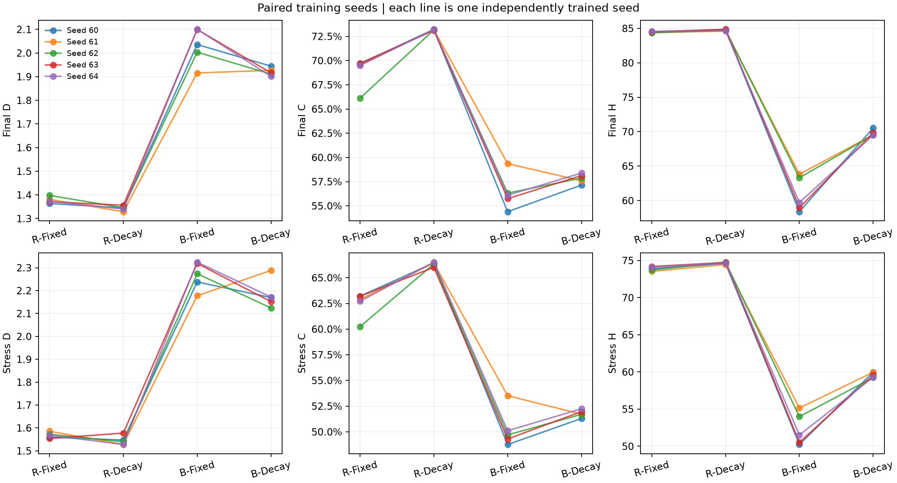
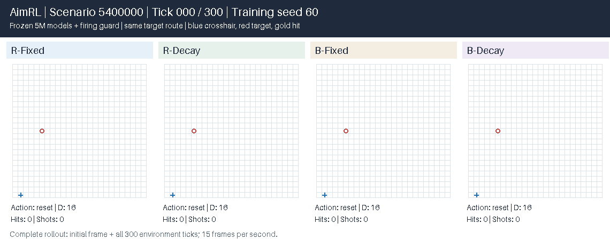

# Boundary information and learning-rate stability

**Question.** Does omitted boundary context or constant update size limit sustained tracking? Four conditions cross the original relative observation (already including heading and speed) or boundary-group augmentation with fixed alpha=0.15 or per-pair decay `0.15*(1+n/1000)^(-0.6)`. Rewards, actions, exploration and 5M budget are held fixed. Five paired training seeds (60–64) give **100,000,000 formal interactions**, plus an independent **4,000,000-interaction pilot**.

R-Decay improves close tracking and cross-seed C stability. The much larger boundary table performs worse at the same budget; those negative results remain included. Neither the relative joint improvement gate nor the absolute C≥75% target is reached in this study. Guarded results below are recalculated from raw windows; entries are mean ± sample SD across five trained seeds.

| Split | Method | Instances | D ↓ | C (%) ↑ | H / 300 ticks ↑ | A (%) |
| --- | --- | --- | --- | --- | --- | --- |
| Final | R-Fixed | 5 | 1.3774 ± 0.0131 | 68.899 ± 1.561 | 84.4564 ± 0.0887 | 100.00 ± 0.00 |
| Final | R-Decay | 5 | 1.3433 ± 0.0099 | 73.185 ± 0.042 | 84.7308 ± 0.1011 | 100.00 ± 0.00 |
| Final | B-Fixed | 5 | 2.0311 ± 0.0767 | 56.384 ± 1.824 | 60.8400 ± 2.5377 | 100.00 ± 0.00 |
| Final | B-Decay | 5 | 1.9200 ± 0.0165 | 57.825 ± 0.482 | 69.7932 ± 0.4381 | 100.00 ± 0.00 |
| Stress | R-Fixed | 5 | 1.5680 ± 0.0123 | 62.447 ± 1.254 | 73.8980 ± 0.2721 | 100.00 ± 0.00 |
| Stress | R-Decay | 5 | 1.5441 ± 0.0205 | 66.349 ± 0.197 | 74.6440 ± 0.1263 | 100.00 ± 0.00 |
| Stress | B-Fixed | 5 | 2.2666 ± 0.0609 | 50.280 ± 1.881 | 52.2820 ± 2.1788 | 100.00 ± 0.00 |
| Stress | B-Decay | 5 | 2.1812 ± 0.0628 | 51.788 ± 0.351 | 59.6140 ± 0.3557 | 100.00 ± 0.00 |

Each GIF has initial state plus all 300 ticks (301 frames, 20.07 s). Programmatic decoding is verified; actual-player inspection was not performed. [Study navigation](tracking_boundary_stability.md) · [report](../results/tracking_boundary_stability/results_summary.md) · [all data](../results/tracking_boundary_stability/) · [other GIFs](../results/tracking_boundary_stability/demos/) · [publication reproduction commands](reproduce_latest_studies.md).

## Paired checks from unrounded records

| Study | Split | Seed | ΔD | ΔC (pp) | ΔH | Relative gate | Stronger gate | C≥75% + hits |
| --- | --- | --- | --- | --- | --- | --- | --- | --- |
| boundary | final | 60 | -0.01865 | +3.5753 | +0.3120 | False | False | False |
| boundary | final | 61 | -0.05216 | +3.6960 | +0.2380 | False | False | False |
| boundary | final | 62 | -0.05215 | +7.0593 | +0.3960 | True | False | False |
| boundary | final | 63 | -0.01466 | +3.3987 | +0.3360 | False | False | False |
| boundary | final | 64 | -0.03285 | +3.7033 | +0.0900 | False | False | False |
| boundary | stress | 60 | -0.01255 | +3.2367 | +0.6900 | False | False | False |
| boundary | stress | 61 | -0.05737 | +3.5483 | +0.9100 | False | False | False |
| boundary | stress | 62 | -0.03267 | +6.0967 | +1.0550 | True | False | False |
| boundary | stress | 63 | +0.02388 | +2.8167 | +0.5400 | False | False | False |
| boundary | stress | 64 | -0.04082 | +3.8083 | +0.5350 | False | False | False |
| planning | final | 60 | -0.13114 | +1.8087 | +4.2600 | False | False | True |
| planning | final | 61 | -0.12793 | +1.8193 | +4.3720 | False | False | True |
| planning | final | 62 | -0.13609 | +1.8207 | +4.2540 | False | False | True |
| planning | final | 63 | -0.14761 | +1.9813 | +4.1900 | False | False | True |
| planning | final | 64 | -0.12309 | +1.7460 | +4.2040 | False | False | True |
| planning | stress | 60 | -0.18955 | +3.0033 | +5.1700 | False | False | False |
| planning | stress | 61 | -0.16938 | +2.7950 | +5.2900 | False | False | False |
| planning | stress | 62 | -0.19022 | +3.0467 | +5.2850 | False | False | False |
| planning | stress | 63 | -0.22872 | +3.4817 | +5.2550 | False | False | False |
| planning | stress | 64 | -0.17918 | +2.8750 | +5.1750 | False | False | False |

[Protocol](../results/tracking_boundary_stability/protocol.json) · [source](../aimrl/tracking_boundary_stability/) · [config](../configs/tracking_boundary_stability.json) · [tests](../tests/test_tracking_boundary_stability.py) · [full results](../results/tracking_boundary_stability/comparison.csv)
