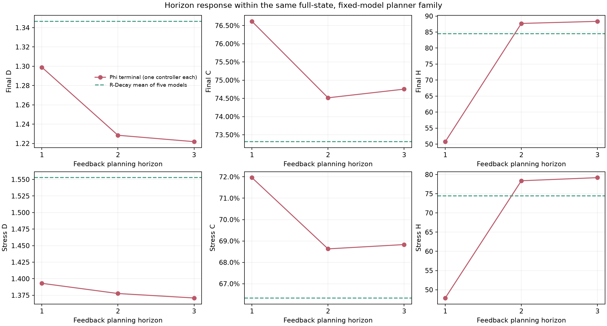
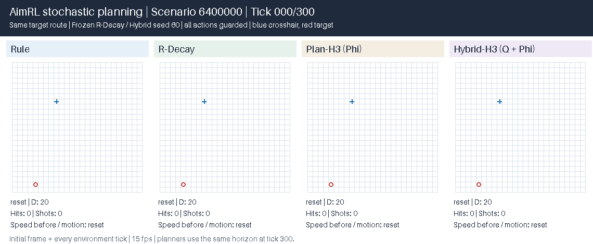

# Short-horizon planning with learned terminal values

**Question.** How much can stochastic feedback planning improve the existing ten-action task, and what comes from horizon versus terminal value? The study reuses frozen models: **zero new training interactions and zero Q updates**. The **20 instances** are Rule (1), R-Fixed (5), R-Decay (5), Phi-terminal Plan-H1/H2/H3 (3), zero-terminal Plan-H3-Zero (1), and learned-terminal Hybrid-H3 (5). Final has **10,000 windows**; Stress has **4,000**, totaling **4,200,000 environment ticks**.

Planners observe full coordinates and a known stochastic model; R uses relative state. These information and computation advantages accompany cross-family differences. H1→H2→H3 within the same Phi family isolates horizon. Zero removes the distance terminal; Hybrid uses `max(Q_shaped)+Phi`, where `Phi=-distance` and task value = shaped value + Phi. In Stress the real turn/toggle probabilities are **0.10**, while every planning model remains **0.05**.

| Split | Method | Instances | D ↓ | C (%) ↑ | H / 300 ticks ↑ | A (%) |
| --- | --- | --- | --- | --- | --- | --- |
| Final | Rule | 1 | 1.3849 | 72.741 | 43.4080 | 100.00 |
| Final | R-Fixed | 5 | 1.3848 ± 0.0137 | 68.898 ± 1.538 | 84.2240 ± 0.2003 | 100.00 ± 0.00 |
| Final | R-Decay | 5 | 1.3465 ± 0.0091 | 73.311 ± 0.078 | 84.5276 ± 0.0611 | 100.00 ± 0.00 |
| Final | Plan-H1 | 1 | 1.2990 | 76.615 | 50.7560 | 100.00 |
| Final | Plan-H2 | 1 | 1.2285 | 74.516 | 87.6940 | 100.00 |
| Final | Plan-H3 | 1 | 1.2219 | 74.753 | 88.3420 | 100.00 |
| Final | Plan-H3-Zero | 1 | 2.4685 | 70.961 | 83.8020 | 100.00 |
| Final | Hybrid-H3 | 5 | 1.2134 ± 0.0025 | 75.147 ± 0.026 | 88.7836 ± 0.0158 | 100.00 ± 0.00 |
| Stress | Rule | 1 | 1.4827 | 67.910 | 41.6050 | 100.00 |
| Stress | R-Fixed | 5 | 1.5752 ± 0.0103 | 62.481 ± 1.275 | 73.9950 ± 0.2589 | 100.00 ± 0.00 |
| Stress | R-Decay | 5 | 1.5527 ± 0.0207 | 66.335 ± 0.216 | 74.4570 ± 0.0391 | 100.00 ± 0.00 |
| Stress | Plan-H1 | 1 | 1.3930 | 71.960 | 47.8600 | 100.00 |
| Stress | Plan-H2 | 1 | 1.3777 | 68.630 | 78.3700 | 100.00 |
| Stress | Plan-H3 | 1 | 1.3709 | 68.832 | 79.1750 | 100.00 |
| Stress | Plan-H3-Zero | 1 | 2.4651 | 65.675 | 75.2500 | 100.00 |
| Stress | Hybrid-H3 | 5 | 1.3613 ± 0.0053 | 69.375 ± 0.076 | 79.6920 ± 0.0445 | 100.00 ± 0.00 |

On this new Final, Hybrid-H3 has D=1.2134, C=75.15%, H=88.784; H is **5.04%** above the same-scene R-Decay mean. All five Hybrid instances reach C≥75% and retain at least 98% of their paired baseline hits. Stress Hybrid C is 69.38%, below 75%. The prespecified relative gate requiring **C gain ≥5 percentage points** still fails. H1's high close score comes with substantial hit loss and is not joint improvement. Pure Rule/planners are single instances and have no invented training-seed SD.

**Different holdouts:** boundary-study R-Decay Final C is 73.19%; planning-study R-Decay Final C is 73.31%. Differences are computed within each study from unrounded counts, never across these tables.

Planning preparation is separately charged in the precomputation record: state backups, chance terms and action-value lookups are distinct from real environment ticks. Formal online use is 1,890,000 cached planning queries, not training updates. Full measured preparation/evaluation costs and timer-resolution caveats are in the report.

Programmatic decoding verified all 301 frames and their timing; actual-player inspection was not performed and no desktop/browser permission was requested. [Study navigation](tracking_planning.md) · [report](../results/tracking_planning/results_summary.md) · [paired results](../results/tracking_planning/paired_differences.csv) · [other GIFs](../results/tracking_planning/demos/) · [reproduce](reproduce_latest_studies.md).

**Next work:** a controlled 2-cell movement-action experiment is proposed, not completed. Preserve the current-action planning baseline and test C and H jointly; these results do not establish a theoretical ceiling.

## Same-model paired improvements

| Study | Split | Seed | ΔD | ΔC (pp) | ΔH | Relative gate | Stronger gate | C≥75% + hits |
| --- | --- | --- | --- | --- | --- | --- | --- | --- |
| boundary | final | 60 | -0.01865 | +3.5753 | +0.3120 | False | False | False |
| boundary | final | 61 | -0.05216 | +3.6960 | +0.2380 | False | False | False |
| boundary | final | 62 | -0.05215 | +7.0593 | +0.3960 | True | False | False |
| boundary | final | 63 | -0.01466 | +3.3987 | +0.3360 | False | False | False |
| boundary | final | 64 | -0.03285 | +3.7033 | +0.0900 | False | False | False |
| boundary | stress | 60 | -0.01255 | +3.2367 | +0.6900 | False | False | False |
| boundary | stress | 61 | -0.05737 | +3.5483 | +0.9100 | False | False | False |
| boundary | stress | 62 | -0.03267 | +6.0967 | +1.0550 | True | False | False |
| boundary | stress | 63 | +0.02388 | +2.8167 | +0.5400 | False | False | False |
| boundary | stress | 64 | -0.04082 | +3.8083 | +0.5350 | False | False | False |
| planning | final | 60 | -0.13114 | +1.8087 | +4.2600 | False | False | True |
| planning | final | 61 | -0.12793 | +1.8193 | +4.3720 | False | False | True |
| planning | final | 62 | -0.13609 | +1.8207 | +4.2540 | False | False | True |
| planning | final | 63 | -0.14761 | +1.9813 | +4.1900 | False | False | True |
| planning | final | 64 | -0.12309 | +1.7460 | +4.2040 | False | False | True |
| planning | stress | 60 | -0.18955 | +3.0033 | +5.1700 | False | False | False |
| planning | stress | 61 | -0.16938 | +2.7950 | +5.2900 | False | False | False |
| planning | stress | 62 | -0.19022 | +3.0467 | +5.2850 | False | False | False |
| planning | stress | 63 | -0.22872 | +3.4817 | +5.2550 | False | False | False |
| planning | stress | 64 | -0.17918 | +2.8750 | +5.1750 | False | False | False |

[Protocol](../results/tracking_planning/protocol.json) · [source](../aimrl/tracking_planning/) · [config](../configs/tracking_planning.json) · [tests](../tests/test_tracking_planning.py) · [per-policy data](../results/tracking_planning/per_policy.csv) · [thresholds](../results/tracking_planning/thresholds.csv)
