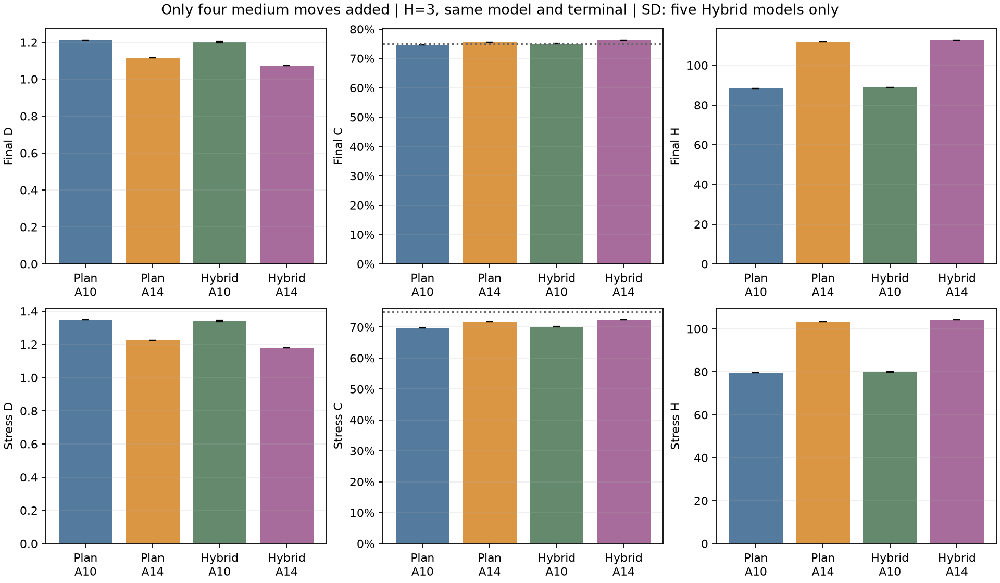
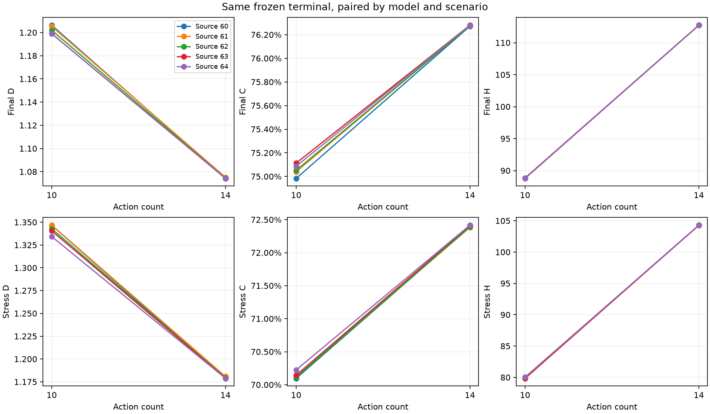
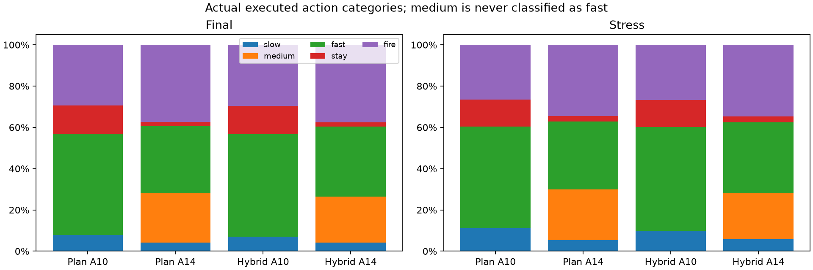
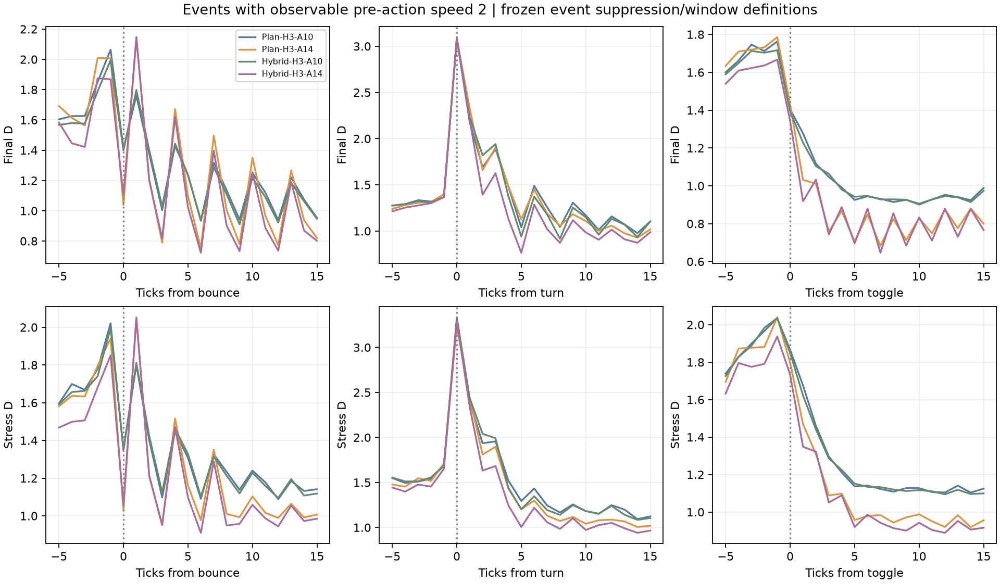
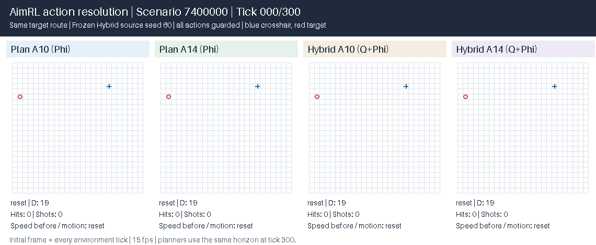

# Do two-cell movements improve continuous tracking?

## Question and controlled intervention

Can adding four one-tick medium cursor moves improve closeness while retaining hit frequency, under the same full physical state, known stochastic model, task reward, H=3 feedback planner and terminal values? A10 IDs 0–9 are unchanged. A14 appends 10=left_medium (-2,0), 11=right_medium (2,0), 12=up_medium (0,-2), 13=down_medium (0,2). Maximum movement remains 3. Movement and firing are mutually exclusive. Every tick moves the cursor once, tests a shot before target motion, consumes the original three random draws, then advances the target once with original unit-substep reflection. Reset and 300-tick windows are unchanged.

The twelve fixed instances are Plan-H3 A10/A14 (one each) and Hybrid-H3 A10/A14 for frozen R-Decay source seeds 60–64 (five each). **New training interactions=0; Q updates=0**. Hybrid terminals always maximize over the **original ten** Q entries; new actions have no learned Q entries and participate in every planning layer. This study tests additional control options in this planner, not a trained fourteen-action Q-learning agent.

## Frozen design and correctness

gamma=0.99; task reward=base_reward+0.5 I(d_post≤1); Phi=-L1. Because old shaped reward=task+gamma Phi(next)-Phi(current), task value=shaped value+Phi. V0=Phi for Plan and max_A10 Q_shaped+Phi for Hybrid, identically in both action sets. Planning uses float64, exact maximum V, and chooses the lowest ID within 1e-10 of maximum; all actions including Fire are enumerated. Same inference-only firing guard. H=3 is also used at the last recorded tick, since truncation is not task termination. Planner probabilities remain 0.05/0.05; Stress uses **real 0.10/0.10**. Planners never receive RNG, scene seed or future route.

All 36 A10/A14 Bellman layers are computed. Every A10 value, policy and expectation equals its historical published array exactly; eleven saved states per historical controller additionally agree action-wise. Python/native value and shaped/task equivalence max error: 2.84e-13 and 2.84e-13. Old-action environment states/rewards/termination/RNG agree step-wise; medium clipping and single target advancement are independently checked. Saved int16 observations are widened in the new index adapter, avoiding arithmetic overflow without editing the historical helper.

For all 3,125,000 valid physical states, all six terminal instances, and h=1,2,3, **V_A14≥V_A10**: 56,250,000 comparisons, minimum difference 0, violations 0, pre-fixed absolute tolerance 1e-9. No tolerance adjustment occurred. Exact stored maxima are distinguished from approximate tied-action selection. This inequality constrains the finite-horizon objective and **does not guarantee** rollout D/C/H improvements. Full arrays and [monotonicity receipt](monotonicity.json) remain auditable.

Development uses 7100000–7100199 (2,400 windows). Final uses 7200000–7200499 (**6,000 windows**), Stress 7300000–7300199 (**2,400 windows**). Formal total **2,520,000 environment ticks**. [Seed audit](seed_audit.json) found no historical range collision. The protocol was frozen after Development/preflight and before Final; all methods retained and no tuning followed Final. Policies share initial state and exact target-route hashes for each scene.

## Results

D is mean post-motion L1 distance, C the post-motion d≤1 fraction, H hits per 300-tick window, A hit/shot accuracy (NA if zero shots). Hybrid entries show five source-model means ± **sample SD**, not tick-level uncertainty. Pure Plan has one instance and no training-seed SD. A10 controls are from **these new scenes**, never the older 75.15%/69.38% figures.

| Split | Controller | D | C | H / 300 ticks | A |
| --- | --- | --- | --- | --- | --- |
| final | Plan-H3-A10 | 1.2120 | 74.6447% | 88.3700 | 100.0000% |
| final | Plan-H3-A14 | 1.1164 | 75.5280% | 111.8980 | 100.0000% |
| final | Hybrid-H3-A10 | 1.2023 ± 0.0034 | 75.0547% ± 0.0492 | 88.8128 ± 0.0227 | 100.0000% ± 0.0000 |
| final | Hybrid-H3-A14 | 1.0745 ± 0.0004 | 76.2769% ± 0.0037 | 112.7332 ± 0.0041 | 100.0000% ± 0.0000 |
| stress | Plan-H3-A10 | 1.3487 | 69.6750% | 79.6100 | 100.0000% |
| stress | Plan-H3-A14 | 1.2240 | 71.7367% | 103.4400 | 100.0000% |
| stress | Hybrid-H3-A10 | 1.3422 ± 0.0052 | 70.1420% ± 0.0494 | 79.9540 ± 0.0778 | 100.0000% ± 0.0000 |
| stress | Hybrid-H3-A14 | 1.1794 ± 0.0009 | 72.3987% ± 0.0147 | 104.2820 ± 0.0135 | 100.0000% ± 0.0000 |

### A14 minus matched A10

All differences below use unrounded integer-derived measurements before formatting.

| Split | Terminal | ΔD | ΔC (pp) | ΔH | H change |
| --- | --- | --- | --- | --- | --- |
| final | Plan | -0.095613 | +0.8833 | +23.5280 | +26.6244% |
| final | Hybrid | -0.127820 | +1.2223 | +23.9204 | +26.9335% |
| stress | Plan | -0.124733 | +2.0617 | +23.8300 | +29.9334% |
| stress | Hybrid | -0.162763 | +2.2567 | +24.3280 | +30.4275% |

Relative practical gate: D does not increase, C gains ≥5 percentage points, H retains ≥98%, A≥98%. Stronger gate replaces H retention with ≥2% improvement. Absolute C≥75% and hit retention are reported separately. Final and Stress never share a baseline.

| Split | Terminal | Level | Seed | Practical | Stronger | C≥75% | C≥75% + H retained |
| --- | --- | --- | --- | --- | --- | --- | --- |
| final | Plan | instance | None | False | False | True | True |
| final | Hybrid | instance | 60 | False | False | True | True |
| final | Hybrid | instance | 61 | False | False | True | True |
| final | Hybrid | instance | 62 | False | False | True | True |
| final | Hybrid | instance | 63 | False | False | True | True |
| final | Hybrid | instance | 64 | False | False | True | True |
| stress | Plan | instance | None | False | False | False | False |
| stress | Hybrid | instance | 60 | False | False | False | False |
| stress | Hybrid | instance | 61 | False | False | False | False |
| stress | Hybrid | instance | 62 | False | False | False | False |
| stress | Hybrid | instance | 63 | False | False | False | False |
| stress | Hybrid | instance | 64 | False | False | False | False |
| final | Plan | family_mean | None | False | False | True | True |
| final | Hybrid | family_mean | None | False | False | True | True |
| stress | Plan | family_mean | None | False | False | False | False |
| stress | Hybrid | family_mean | None | False | False | False | False |

### Paired uncertainty

2,000 percentile bootstrap replicates, pre-fixed seed 20261114 with split/terminal offsets. Whole paired scenes are resampled; Hybrid also resamples paired source models, using the same scene draw across all models. Pure Plan resamples scenes only. The five terminal models remain matched across action sets. No tick is treated as an independent observation. These are descriptive bootstrap intervals with only five source models, not a claim of broader model-family certainty.

| Split | Terminal | Metric | 95% paired lower | upper |
| --- | --- | --- | --- | --- |
| final | Plan | D | -0.102200 | -0.089286 |
| final | Plan | C | 0.006953 | 0.010660 |
| final | Plan | H | 22.937950 | 24.152150 |
| final | Plan | A | 0.000000 | 0.000000 |
| final | Hybrid | D | -0.132750 | -0.122171 |
| final | Hybrid | C | 0.010604 | 0.013792 |
| final | Hybrid | H | 23.322270 | 24.530010 |
| final | Hybrid | A | 0.000000 | 0.000000 |
| stress | Plan | D | -0.135367 | -0.113347 |
| stress | Plan | C | 0.017000 | 0.024150 |
| stress | Plan | H | 23.049750 | 24.615000 |
| stress | Plan | A | 0.000000 | 0.000000 |
| stress | Hybrid | D | -0.171864 | -0.154266 |
| stress | Hybrid | C | 0.019683 | 0.025554 |
| stress | Hybrid | H | 23.545975 | 25.161100 |
| stress | Hybrid | A | 0.000000 | 0.000000 |

## What changed at speed 2 and in control behavior?

The table conditions on **decision-time observable** speed=2. H is normalized to 300 slice ticks; it is not total-window H. Actual post-toggle speed has a distinct table slice, avoiding look-ahead in policy interpretation. Target-speed slice membership is common across policies; cursor-boundary and acquisition slices are policy-dependent and descriptive.

| Split | Terminal | Speed-2 ΔD | Speed-2 ΔC | Speed-2 Δhits/300 slice ticks |
| --- | --- | --- | --- | --- |
| final | Plan | -0.010448 | +0.007915 | +1.022235 |
| final | Hybrid | -0.073471 | +0.015115 | +1.785132 |
| stress | Plan | -0.046216 | +0.020610 | +1.384407 |
| stress | Hybrid | -0.126193 | +0.029638 | +1.911106 |

| Split | Controller | Slow | Medium | Fast | Stay | Fire | Medium actual 2 | actual 1 | actual 0 |
| --- | --- | --- | --- | --- | --- | --- | --- | --- | --- |
| final | Plan A10 | 7.931% | 0.000% | 49.027% | 13.585% | 29.457% | 0 | 0 | 0 |
| final | Plan A14 | 4.089% | 24.009% | 32.539% | 2.064% | 37.299% | 36013 | 0 | 0 |
| final | Hybrid A10 | 6.999% | 0.000% | 49.744% | 13.653% | 29.604% | 0 | 0 | 0 |
| final | Hybrid A14 | 4.272% | 22.239% | 33.811% | 2.100% | 37.578% | 166795 | 0 | 0 |
| stress | Plan A10 | 11.112% | 0.000% | 49.268% | 13.083% | 26.537% | 0 | 0 | 0 |
| stress | Plan A14 | 5.387% | 24.470% | 32.897% | 2.767% | 34.480% | 14682 | 0 | 0 |
| stress | Hybrid A10 | 9.840% | 0.000% | 50.317% | 13.191% | 26.651% | 0 | 0 | 0 |
| stress | Hybrid A14 | 5.881% | 22.212% | 34.414% | 2.732% | 34.761% | 66637 | 0 | 0 |

Medium's nominal displacement is always 2, while clipped actual motion is counted separately as 2/1/0. [Action usage](action_usage.csv) includes speed, boundary/interior and pre-distance state distributions, overshoot and immediate reversal counts. [Speed/boundary slices](speed_boundary_slices.csv) include pre/post speed, boundary, speed×boundary, initial acquisition and strictly post-acquisition sustained tracking. [Common-state comparisons](diagnostics/common_comparison.csv) compare all six terminal pairs on the same previously frozen physical states; common-state action/value differences are distinct from own-rollout slices.

The fixed selection rules retain the first observable-speed-2 medium disagreement, first accepted bounce with different alignment recovery, and first qualifying medium disagreement with a worse A14 own-route distance. [Selection and absence records](behavior_selection.json) and [full behavior fragments](behavior_fragments.csv) preserve both routes' real states/actions, including regressions. Own-route regressions after diverging states are descriptive, not a causal one-step action contrast. Overshoot means crossing the *current* target coordinate on its exact row/column; reversal means successive opposite-axis-direction commands. Neither alone proves causal correction. Hits, alignment opportunities and alignment-conditioned firing rates are shown together in per_policy/per_seed and slice tables.

[Mechanism paired changes](mechanism_comparison.csv) tabulate slow/fast/medium/Stay/Fire, crossing, reversal and unaligned-wait rate changes. Hit timing matters: a pre-motion hit followed by actual speed-2 target motion normally ends at d_post=2, so that tick contributes H but not C. The mutually exclusive close / hit-outside-close accounting is independently checked in every window; a large hit gain need not produce a comparably large C gain. The following partition is shown for the single Plan and fixed display model 60 (all models remain in data):

| Split | Controller | C | Hits ending outside close / all ticks |
| --- | --- | --- | --- |
| final | Plan-H3-A10 | 74.645% | 14.136% |
| final | Plan-H3-A14 | 75.528% | 14.615% |
| final | Hybrid-H3-A10_s60 | 74.983% | 14.256% |
| final | Hybrid-H3-A14_s60 | 76.272% | 14.812% |
| stress | Plan-H3-A10 | 69.675% | 12.043% |
| stress | Plan-H3-A14 | 71.737% | 12.778% |
| stress | Hybrid-H3-A10_s60 | 70.097% | 12.083% |
| stress | Hybrid-H3-A14_s60 | 72.393% | 12.927% |

Event windows remain [-5,+15], same-type suppression 30 ticks; turn/toggle recovery requires three consecutive close ticks within horizon 30 and is censored at the next random event/window/horizon. Bounce curves keep overlaps with other event types. Alignment recovery after a bounce uses first subsequent pre-action alignment within 30 ticks. [Recovery](recovery.csv) and [high-speed event curves](high_speed_event_curves.csv) preserve these definitions. No event or fragment is selected for better A14 performance.

## Compute, integrity and delivery

Precomputation: 40.887 s; **112,500,000 value backups**, 657,000,000 chance-transition terms, 1,350,000,000 action-value lookups and 1,237,500,000 reused expectations. Half of the value backups are explicit A10 reconstruction checks, half A14. Peak working set during precompute: 214.07 MiB (process lifetime, not stage-attributed allocation). Formal evaluation/storage: Final 15.345 s and Stress 6.740 s. Per-policy load/storage time and lookup latency are in [runtime tables](evaluation/final/runtime.csv); online planning performs a table query, no model expansion. Offline computation is not free.

[Execution accounting](execution_accounting.json) separates formal 8,400 windows/2.52M ticks, Development 2,400/720,000, all validation runs, demos 12/3,600, and common-state diagnostics (zero environment ticks). Precomputation and environment interactions are separately counted. Native compiler: Zig 0.15.2, C11 -O3 -fno-fast-math -ffp-contract=off; [build receipt](native/build.json). Timing includes this host's overhead and compression and is not a hardware-independent benchmark.

Historical released files are protected by a 3,662-file hash baseline; [integrity proof](historical_integrity.json). The five Q/count tables are read-only and their hashes match before/after. No historical source, protocol, cache, result or Git identity was changed. This run performs no commit or push. Failed setup attempts are retained honestly and preceded all holdout evaluation. [Check commands](preflight/commands.json), [postflight](postflight/commands.json), [inventory](output_inventory.csv) and [inventory hash boundary](inventory_scope.json) provide acceptance evidence. Final acceptance is recorded after checks, outside its own inventory hash boundary.

## Figures, complete demos and next step

Three four-panel demos: Plan A10, Plan A14, Hybrid A10, Hybrid A14; Hybrid always source seed 60. Target route is shared, cursor policies run independently. Each GIF contains the initial frame and all 300 ticks. Full decoded pixels and durations were compared against all rendered frames; 301 frames/20,070 ms each. **Actual-player inspection was not performed**, and no Chrome/desktop permission was requested.

The matched effects are consistently favorable under both terminals and all five source models. Prioritize a separately preregistered fourteen-action training study to test whether a learned controller can exploit this control option without full-state model-based DP. Keep this zero-training action-resolution result as a complete paper section; do not silently retune this holdout. The current learned terminal remains ten-action-derived.

- [Scenario 7400000 GIF](demos/scenario_7400000/synchronized.gif)
- [Scenario 7400001 GIF](demos/scenario_7400001/synchronized.gif)
- [Scenario 7400002 GIF](demos/scenario_7400002/synchronized.gif)
- [Reproduce and rebuild](REPRODUCE.md), [conclusions](conclusions.md), [paper addendum](paper_addendum.md)

[Detailed behavioral interpretation](behavior_interpretation.md) (post-analysis narrative from the frozen tables; no experiment change).
